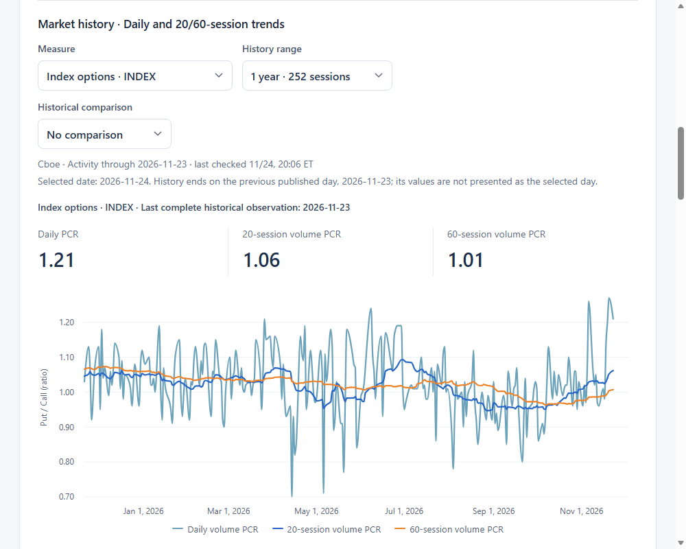
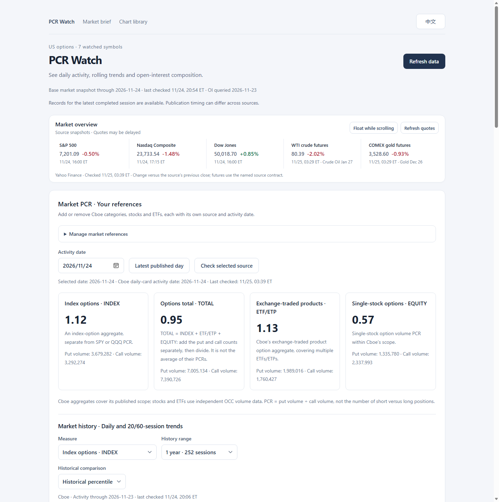
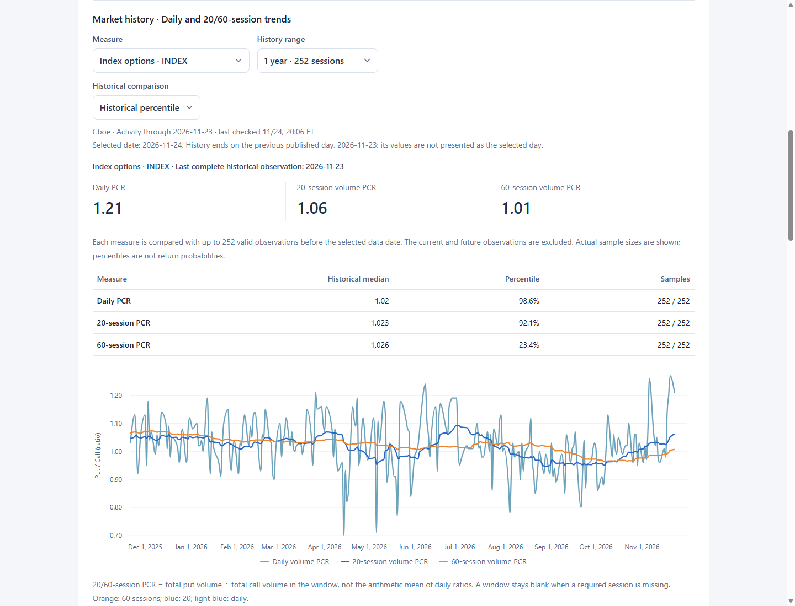

# PCR Market Watch

**English** | [简体中文](README.zh-CN.md)

Explore U.S. options activity through daily Put/Call Ratios, 5-, 20- and 60-session trends, historical percentiles, and prior-year comparisons.

[Project homepage](https://rexmiao.github.io/pcr-market-watch/) · [Download](https://github.com/Rexmiao/pcr-market-watch/releases/latest) · [Full product specification](docs/PRODUCT_SPEC.en.md)





**Latest Windows release: [v0.2.18](https://github.com/Rexmiao/pcr-market-watch/releases/tag/v0.2.18)**, published 2026-11-27. It includes Gamma/Max Pain, daily per-expiry archive/history support and English on first use. Configure your own market-data authorization and daily task; personal data and credentials are not bundled. Versioned sections below retain their original introduction/verification history; v0.2.3 is a historical release with unchanged assets.

## Features

- **Market references:** Cboe INDEX, TOTAL, ETF/ETP, and EQUITY categories, plus stocks or ETFs you add. Every initial recommendation can be removed.
- **Quote-overview shortcuts (v0.2.11):** Jump to Market PCR, Index ETFs, Watchlist or Symbol history from the quote card.
- **Personal watchlist:** Search tickers, press Enter to add, organize groups, and remove symbols. The list uses the deployment’s SQLite, independently of market references. Local and cloud databases are separate.
- **PCR rule observations (v0.2.13):** Separate same-date 5/20/60 ordering from exact-prior-session changes and descriptive continuation rules.
- **PCR change summary (v0.2.12):** Current references/watchlists, actual dates, previous-session ratio changes, 5/20/60-session values and 20-session percentiles with sample counts.
- **Daily archive diagnostics (v0.2.9 source):** Owner-only execution evidence, monitoring coverage and safe authorization state, separate from the existing schedule.
- **Historical trends:** Daily, 5-session, 20-session, and 60-session volume PCR, with a date selector and adjustable display range.
- **Historical context:** Percentiles, medians, and sample counts for each PCR measure. Prior-year comparison shows one selected measure at a time.
- **Supporting quotes:** Three major U.S. stock indices, crude oil, gold and Bitcoin BTC/USD, each with its own source timestamp. The floating quote strip can be unpinned; crypto change is relative to the source previous close, not a strict rolling 24-hour return.
- **Optional moomoo integration:** Read-only market data through local desktop or separately authorized backend WebAPI. No trading or account operations are exposed.
- **Gamma / Max Pain (v0.2.17 source):** 30-day Gamma with nearest/seven-day/all scopes, an excluding-nearest comparison, provider walls/zero-Gamma levels, and independent single-expiry Max Pain. The chart defaults to Auto to include key prices, with manual Near/All views retained. Availability depends on returned data and quote entitlements; these are model references, not observed dealer inventory or price targets.
- **Durable structure history (v0.2.17 source):** Save each actual expiry within 30 calendar days for Gamma and single-expiry Max Pain, plus 30-day/excluding-nearest Gamma. Compare saved query days, expiries and capture times. A separate 17:45 New York task stores private database observations; sleep, permissions and collection budgets can leave explicit gaps.
- **Saved OI by query day (introduced in v0.2.6):** Exact-date gray bars, original query times, confirmed-or-unknown settlement dates, and a separate daily 17:30 ET archive task.
- **Guest PCR and owner controls (v0.2.7 source):** Optional password-free charts and explicit data refresh, with shared 60-second update budgets. Owner login protects list/group edits and private pages; the Bucket stays private. [Hosting guide](docs/HUGGING_FACE.en.md).
- **Options activity monitor (since v0.2.0):** Select a symbol and auto/desktop/webapi. Desktop scans at most 20 nearby strikes/40 contracts. Optional WebAPI works without the desktop client and provides provider summaries/unusual events with separate credentials and permissions.



## Windows quick start

1. Install [Node.js 22 or newer](https://nodejs.org/en/download) and [Python 3](https://www.python.org/downloads/). You can select the option to add Python to PATH during installation.
2. Download the Windows ZIP from [Releases](https://github.com/Rexmiao/pcr-market-watch/releases/latest) and **extract it completely**.
3. Double-click `start.cmd`. Keep the CMD window open while using the application; minimizing it is fine.
4. Open the actual address printed by CMD: **http://127.0.0.1:8765/** by default, or an available port such as **http://127.0.0.1:8766/** if another program occupies it.

The Windows ZIP includes the built application. The first run creates the database and initial lists. It does not contain the author's personal database, credentials, or browser profile.

Closing the browser does not stop the backend. Closing the CMD window that owns the server stops that local server. Double-click `start.cmd` to start it again.

If Python is not on PATH, set `PCR_PYTHON` to its executable path. Set `PCR_DB_PATH` to choose a database location; the default is `local-data/pcr.sqlite3`, one directory above the project.

## Run from source

```sh
git clone https://github.com/Rexmiao/pcr-market-watch.git
cd pcr-market-watch
npm ci
npm run build
npm start
```

Open http://127.0.0.1:8765/. Node.js and Python 3 are required. The development dependencies installed by `npm ci` support source builds and database migration development.

```sh
npm test
node scripts/validate-artifact.mjs
```

## Use the options activity monitor

v0.2.1 fixes Auto source selection to prefer a configured WebAPI connection. Explicit desktop/webapi choices remain available; collection errors never silently switch source.

In v0.2.2, open **Options activity** in the top navigation between PCR and Market brief. Its dedicated `/options-monitor.html` page starts expanded; select a current-list stock/ETF and auto, desktop, or webapi. The PCR homepage does not poll options activity; its separate OI summary refresh is manual. Use the actual address printed by the launcher followed by `/options-monitor.html`; [page source](web/options-monitor.html). Desktop mode selects an expiration for bounded contract-quote observations/actual prints. WebAPI supplies provider underlying summaries and unusual events; an expiration filter affects events only, not summary PCR.

WebAPI can operate without moomoo Desktop. Run `node scripts/connect-moomoo-webapi.mjs` and approve the quote:read market-data capability through moomoo's official OAuth PKCE page. Valid provider account-context selectors do not grant account/position access; write, trade, and unknown capabilities remain rejected. A local callback receives authorization; the bundle is stored with Windows DPAPI outside the project, and the backend refreshes using actual expiry information. Grants can expire or be revoked and may need reconnection; access is not permanent. Do not paste tokens into chat or reuse desktop AppKey as Bearer. `scripts/configure-moomoo-webapi.mjs` runs the same OAuth flow. Windows setup has no manual-token mode; browsers never hold secrets, and tokens are never written to .env. The optional Linux cloud runtime uses independent quote:read OAuth with encrypted Secret bootstrap and automatic access renewal while its refresh grant remains valid. Refresh expiry/revocation still needs official reconnection; Windows DPAPI is never uploaded.

Desktop requires signed-in moomoo, external access, and options permissions, scanning at most 20 strikes/40 contracts. It obtains selected-contract fields from basic quotes in batches of at most 20; it does not require the separate full-snapshot endpoint to succeed. WebAPI unusual events are capped at 300 rows per batch with pagination/truncation notices, not a complete tape. Undisclosed exchange/expiration coverage, source times, and exact OI settlement dates stay unknown. Ratios identify their source and do not replace Cboe/OCC historical series.

Initial 500-contract and Volume/OI-of-2 thresholds are editable screening rules. Optional 30/60/120-second refresh runs only while expanded and visible, pausing when hidden/closed without closed-page notifications. Provider BUY/SELL is not an opening/closing flag. Cumulative-volume increments are not one large trade; OI-observation changes do not confirm new shorts or closing trades. Failures remain explicit, retain original data times, never fabricate trades, and do not automatically switch source.

v0.2.3 cards show provider BUY/SELL/NEUTRAL classification and record date/time to the second in New York ET; open/close remains **undisclosed**. Activity cards match their original event; snapshot and interval cards label observation/check times instead. Missing times stay unknown. Put type, side, and OI do not establish net long/short positioning or opening/closing.

Orange highlights mean a screening threshold was met, not bullish/bearish. Read the displayed expiration, strike, and Call/Put. A contract can repeat or meet multiple rules; alert counts are not unique openings or trader counts.

The local Node backend and computer must remain running. Always-on cloud collection needs a separately deployed backend and server secret. GitHub Pages only introduces the project/download and cannot run collection or hold private tokens. This version's hosted Worker has no WebAPI collection path. Existing Sites cloud versions are not automatically updated by local packages.

## Local one-time review (unpublished)

The local working copy adds a read-only quote-capture/reminder tool, separate from the published v0.2.3 ZIP. A private configuration chooses stocks/options, spread legs, and one schedule/cutoff. Results remain outside the project under private `local-data/quote-reviews`; no trading, automatic AI analysis, or remote notifications. See the [backend setup](docs/MOOMOO_BACKEND.en.md) for capture/Windows registration commands and the [Product Spec](docs/PRODUCT_SPEC.en.md) for rules.

The user must be signed in with the computer and network available. Sleep wake-up is attempted without a guarantee; shutdown cannot run it. Missed execution only catches up before its cutoff, otherwise it records a missed capture. Use `--dry-run` first: no credential reads, network, output writes, or reminders. Registration is not proof of future execution. Existing release files are unchanged; this addition is not published.

## Scheduled reviews and archives (v0.2.4, local/unpublished)

Open **Scheduled reviews** in the local navigation at `/quote-reviews.html` ([page source](web/quote-reviews.html)). View actual Windows state/next run, latest results, and reports filtered by actual run date in New York ET. Refreshing state does not execute a task. Manual tests remain labeled manual; scheduled, actual, and provider times stay separate.

Local `local-data/quote-reviews` retains manual/scheduled/failure/missed reports without automatic cleanup. The page shows archive counts/bytes for per-run JSON+HTML (excluding private configuration/receipts) and safe discovered-report downloads. Filters/page changes affect the run list, while job/storage totals stay complete. Private results are not uploaded to GitHub or included in the public ZIP; they are local disk use rather than repository files. Cloud/Pages show local-only support. This working copy is not published; the existing v0.2.3 release remains unchanged.

## Local v0.2.5 clarity updates (unpublished)

Market brief identifies each failed or waiting source rather than marking healthy data failed. Its local quote bridge prefers configured WebAPI; desktop is used only when cloud setup is absent, and errors never silently switch source. Three index-summary percentages are bold while signs/dates stay intact.

Calendar blue dots mean at least one symbol has volume records; counts/missing-symbol lists use the complete watchlist regardless of category filters, without promising every symbol, window, or OI is available. Historical OI does not borrow today's snapshot, and missing reliable latest OI explains its cause. This local update retains v0.2.4 and is not published to GitHub; public v0.2.3 files remain unchanged.

## Local v0.2.6 OI archives and hosting preparation (unpublished)

Each actual Moomoo summary query appends an immutable private SQLite observation. Select a historical date to see that day's last saved gray OI bar, independently of the volume chart's fallback date. Blue calendar marks indicate volume records; gray marks indicate saved OI observations. The original query time is displayed in New York ET; settlement date is shown only when the provider explicitly confirms it. The existing provider currently leaves it unknown. Legacy cache import preserves original timestamps and cannot reconstruct days never saved.

The separate **PCR-OI-Daily-Snapshot** Windows task captures the current persisted watchlist every calendar day at **17:30 America/New_York**. A signed-in user, powered-on computer, valid quote-only authorization, and network are required; neither the webpage, preview server, nor moomoo desktop needs to remain open. Shutdown cannot run a task. View actual next run/state and latest saved counts through the daily OI status panel; reading status never executes collection. The existing one-time quote-review task stays separate. Personal archives remain outside source and are not uploaded to GitHub.

A private **Hugging Face Docker Space** package is prepared with Node 22/Python 3, password protection, quote:read runtime Secrets, and consistent backups to an attached private Storage Bucket. Live SQLite stays on container disk. A sleeping/stopped Space cannot collect, and cloud authorization needs manual renewal at expiry; this is not permanent OAuth connectivity. Current compute-plan/storage terms require separate account setup and resource choices. See the [English deployment guide](docs/HUGGING_FACE.en.md). At the v0.2.6 preparation stage no Space had been deployed; the newer v0.2.7 status below applies now. Published v0.2.3 release files remain unchanged.

## v0.2.7 HF cloud: guest PCR reading and refresh

[Space](https://huggingface.co/spaces/Rexymiao/pcr-market-watch) · [Application](https://rexymiao-pcr-market-watch.hf.space) · [Hosting guide](docs/HUGGING_FACE.en.md)

The user selected a public Space with password-free PCR charts and explicit source updates. PCR_PUBLIC_VIEW=1 enables the new guest mode; its code/container/frontend checks pass, and actualHF anonymous HTTP/24 realEdge checks have passed. Generic Docker defaults to0. Owner login still protects adding/removing symbols, groups, market-reference configuration, administration and private pages. Public preferences are readOnly:true/canRefresh:true: configuration is read-only, data refresh is allowed.

Guests retain dates, chart ranges and Chinese/English switching. Refresh operations share60-second cooldown/coalescing, returning429/retry timing when busy or cooling down. Cboe date navigation reads verified cache only; a missing day stays empty with refresh_required until an explicit budgeted POST update. Public custom-symbol/OI routes follow the current published watchlist/references; the generic default-seven core data already in source remains a documented frontend baseline. Private group names, accounts/positions, credentials and raw private provider records stay hidden. The Bucket and encrypted quote grants remain private/server-side.

Independent quote OAuth, actual7/7 OI archives, owner form/session login and paused-update recovery were already verified. Settlement dates remain unknown. Actual signed-outHF homepage/data/refresh and owner-boundary checks passed: public200, refresh7/7 then429, private401 and cross-origin403. All24 fresh signed-outHF Edge checks also passed; earlier owner checks remain separate evidence. The cloud17:30 daily plan is enabled but future execution unobserved. CPU Basic/refresh-grant expiry and incomplete-backup crash windows remain; no extra paid Jobs/hardware were enabled. Confirm latest backup, pause untilPAUSED, then upload/start. Published GitHubv0.2.3 artifacts remain unchanged.

## Data and interpretation

**PCR = put quantity ÷ call quantity. It is not the proportion of investors who are short, a capital allocation ratio, or a probability of a price move.**

- The 5-, 20- and 60-session volume PCRs divide total put volume by total call volume over each window. They are not arithmetic averages of daily PCRs.
- Cboe and OCC have different coverage, publication schedules, and available history. Cboe TOTAL covers the products in its report; it is not an all-U.S.-exchange total.
- Older EQUITY observations are derived by subtracting INDEX and ETP put and call volumes separately from TOTAL, then calculating the ratio. The interface identifies these derived observations.
- Homepage Moomoo OI now uses the selected New York query-day archive. Gray bars require an actual observation saved on that day; volume-date fallback never changes the OI day. Show original query time and confirmed settlement date separately, with undisclosed settlement dates left unknown. No saved history is invented. Saved Cboe snapshots remain an explicit separate source. Missing OI is not zero, and zero call OI leaves PCR blank.
- Historical percentiles use up to 252 valid observations before the selected data date, excluding the current and future observations. Actual sample counts are displayed when history is shorter.
- Prior-year curves match the same calendar month and day; missing observations remain blank. For the summary only, a closed-market date can use the latest record within the preceding seven calendar days. Both the target date and actual comparison date are shown.
- When a source has not published a new record, the application retains its last available observation and does not label it as today's data.

Public historical snapshots support display and calculation; their own data dates apply. Publishing the code does not change third-party data rights or terms. See [CBOE_SOURCE_SCOPE.en.md](docs/CBOE_SOURCE_SCOPE.en.md) and [PRODUCT_SPEC.en.md](docs/PRODUCT_SPEC.en.md) for source coverage and methodology.

## Project structure and specifications

| Path | Purpose |
| --- | --- |
| `web/` | Pages, charts, calendar, language switching, historical comparisons, and watchlist interactions |
| `worker/` | Web APIs and data-source adapters |
| `db/`, `drizzle/` | Configuration schemas and versioned migrations |
| `scripts/` | Build tools, local SQLite service, moomoo adapter, and checks |
| `data/` | Dated public-market snapshots |
| `docs/PRODUCT_SPEC.en.md` | User stories, requirements, APIs, algorithms, database constraints, and acceptance criteria |
| `docs/RELEASE_SPEC.en.md` | Release contents, installation behavior, and release verification |
| `site/` | GitHub Pages project showcase; it does not run the full backend |

The current release runs locally. Cloud D1 storage and identity configuration require a separate deployment. GitHub Pages cannot run the SQLite or desktop moomoo backend.

See [MOOMOO_BACKEND.en.md](docs/MOOMOO_BACKEND.en.md) for desktop setup, permissions, and read-only endpoints. Configure the AppKey locally; no key is distributed with the release. There is currently no persistent cloud-to-desktop bridge, AI chat, dealer GEX calculation, or order-entry feature.

### Cache persistence and verified recovery

An earlier restart exposed memory-only Core/Cboe cache loss, despite watchlist/OI/grant recovery. Migration0007 now adds cloud-only worker_cache (compressed body_gzip_base64) to private SQLite backups. Actual source e4a1282 paused/same-commit restart preserved Core/Cboe dates, original checkedAt and row/snapshot SHAs,252 Cboe history rows and35 OI observations using GET only, without another source refresh. Full npm test passed 78 Node cases plus model/source checks. The old failure is historical; current guest/owner, privacy, capacity/expiry and no-extra-fee boundaries are unchanged. Future17:30 triggering is unobserved.

### Administrator login configuration (v0.2.8)

Administrator passwords allow10–256 characters; the generic default username remains pcr. Rotate the application username/password through cloud runtime settings; existing sessions then require a new sign-in. Watchlists, archives and private storage are retained, and the separate moomoo encryption key/quote authorization stay unchanged. Actual cloud rotation passed: selected new credentials work, old credentials/sessions are rejected, and prior watchlists/42 OI observations and Core/Cboe hashes remain. Guest viewing/refresh and separate quote authorization are unchanged. Earlier v0.2.7 evidence and the GitHub v0.2.3 release remain unchanged. See the [administrator configuration contract](docs/HUGGING_FACE.en.md).

## PCR change summary and daily archive diagnostics (v0.2.9 source)

The homepage summary follows your current market references and personal symbols, deduplicated without a fixed seven-symbol list. It uses the homepage date and labels each row's actual data day. View daily PCR, the signed ratio change from the exact preceding U.S. session, source-defined 20/60-session PCR, and the 20-session historical percentile with actual n/252 samples. Gaps and invalid denominators remain blank. Percentiles exclude current/future observations and do not represent return probabilities or net market positions.

The existing owner-only daily OI status area separates scheduled execution from manual observations, waiting plans from absent records, and safe authorization metadata from actual capture results. Diagnostic reads do not fetch market data or renew credentials. Monitoring starts from a recorded activation time rather than inventing older failures. CPU Basic sleep limits still apply; a visit cannot reconstruct unsaved OI and no paid hardware/Jobs are enabled automatically.

v0.2.9 source daaf0dd passed actual HF checks: 99 Node cases plus model/source checks, 27 fixture-browser, 13 real anonymous-cloud browser and 12 read-only HTTP checks. The dynamic summary currently has 11 deduplicated rows and keeps each actual date; owner diagnostics are waiting before 17:30 with no scheduled evidence yet. Saved authorization metadata may show refresh_needed without a network failure. Prior preferences, 42 OI observations, market-cache hashes and credentials remain. First actual 17:30 execution is still unobserved; manual captures/Ready do not prove it. See the [Product Spec](docs/PRODUCT_SPEC.en.md) and [hosting guide](docs/HUGGING_FACE.en.md). GitHub v0.2.3 release files and the existing administrator credentials/data remain unchanged.

## Quote-overview shortcuts (v0.2.11)

The quote card provides four shortcuts: [Market PCR](https://rexymiao-pcr-market-watch.hf.space/#cboe-panel), [Index ETFs](https://rexymiao-pcr-market-watch.hf.space/#market-etf-reference), [Watchlist](https://rexymiao-pcr-market-watch.hf.space/#watchlist-panel) and [Symbol history](https://rexymiao-pcr-market-watch.hf.space/#history-panel). This replaces v0.2.10's top-navigation Watchlist entry. The shortcuts remain available when the card is unpinned, clear its floating height, support keyboard/reduced motion and focus a section without opening the mobile keyboard.

Market/ETF navigation keeps the current matching saved choice or selects the first saved item. If all matching references were removed, or settings are loading/failed, that shortcut is disabled with a reason; it never adds them back. ETF navigation uses the existing shared trend chart. View selection may read cached data with GET, without source refresh, search, preference writes or new polling. Dates, ranges, saved references and guest/owner permissions remain unchanged. Build/artifact validation, 7 related frontend tests and 33 fresh-profile fixture-browser checks passed; local installation was verified with saved data/tasks retained. Cloud deployment/recovery uses separate runtime evidence as required by the [Product Spec](docs/PRODUCT_SPEC.en.md); local tests do not prove cloud completion, and earlier v0.2.10 results remain historical.

## 5-session volume PCR and clearer comparisons (v0.2.12)

The summary, Cboe/index-ETF history and individual-symbol history add **5-session volume PCR**: total Put contracts divided by total Call contracts across the window, rather than the mean of five daily ratios. Existing cached daily counts supply it without new collection. Cboe requires five consecutive expected sessions; OCC retains its last-five-acquired-record rule. Insufficient/missing quantities or zero total Call leave a gap; existing 20/60 values and OI are unchanged.

Charts/statistics now cover daily/5/20/60, with teal for five sessions; the existing Cboe/ETF historical percentile/prior-year comparisons include five sessions with independent samples and no future observations. The summary's percentile still describes 20 sessions. Full **20-session PCR > 60-session PCR**, **<** or **=** labels include hover/keyboard-focus explanations of relative Put-versus-Call activity, without implying positions or future direction. Original dates, navigation, permissions and quote consent remain. Calculation/history/summary/calendar checks passed 32/32, including 8 new five-session cases, and fresh-profile browser fixtures passed 22/22 without JS errors or POST/PUT. Build/artifact validation and local installation passed with original data/tasks retained. Actual cloud deployment/recovery uses independent runtime evidence as required by the [Product Spec](docs/PRODUCT_SPEC.en.md).

## Ordering and changes describe different things (v0.2.13)

A new compact summary reading and the selected symbol/Cboe-ETF history reading show **5/20/60-session PCR ordering**, each window's signed change from its **exact preceding U.S. session**, and a descriptive state. Ordering can remain 5 > 20 > 60 while every window is falling. Missing dates are not replaced with the previous available row; known arrows can remain visible while the overall reading reports insufficient data. A non-session actual anchor keeps its original date/values/order with unknown directions rather than a continuity claim.

A continuation label requires both five- and 20-session PCR to move the same way in all three comparisons across four exact sessions. Current agreement alone is unconfirmed; 60 sessions supplies its own separate background. Hover or focus the rule help for the rules and limitations. The 1e-12 tolerance handles floating-point noise, not market significance. These are observations, not backtested trading signals or price forecasts: rolling windows overlap, and fewer Calls alone can raise PCR. Existing ratios, dates, OI, navigation and permissions remain unchanged. Interpretation/summary checks passed 22/22, with 8 five-session regressions, 7 permissions/frontend checks and final browser fixtures at 18/18 without JS errors or POST/PUT. Build/artifact validation and local installation passed with original data/tasks retained. Actual cloud delivery/recovery requires independent runtime evidence under the [Product Spec](docs/PRODUCT_SPEC.en.md).

## Gamma and Max Pain (v0.2.14 source)

Open **Gamma / Max Pain** at `/option-structure.html` ([page source](web/option-structure.html)). Gamma defaults to 30 calendar days from the New York query day and can select nearest expiration, seven days or all. Compare the selected set with its nearest expiration removed. Strike bars and the total profile at hypothetical spot prices are separate charts, with provider Call/Put Walls and all returned zero-Gamma points. A one-expiry exclusion has no remaining data. If the exact provider expiration filter exceeds its 256-character limit, the comparison reports unavailable rather than silently replacing all expirations with 30 days.

Max Pain selects its own single expiration. It describes minimum aggregate theoretical expiration intrinsic payouts for fixed OI/contracts, not actual strategy P/L, manipulation or a price target. Fixed-OI Max Pain does not change merely because spot changes; spot-to-pain distance does. Gamma can change with spot, time, IV and inventory data. Each view retains its own scope, provider update time and retrieval time; missing times/values stay unknown and failed refreshes label retained data. Undisclosed provider units are not claimed as dollars per 1%.

Load/selection reads cache only. Explicit refresh uses existing quote:read authorization, without a desktop requirement in WebAPI mode or account/trade access. Public symbols remain restricted and Gamma/Max Pain each share a 60-second refresh budget across visitors. New snapshots use bounded process cache, without historical archival or restart-persistence promises; PCR/OI history and tasks remain separate. Local provider probes succeeded; application/browser/local installation/HF deployment need their own verification records. The GitHub v0.2.3 installer remains unchanged. See the [Product Spec](docs/PRODUCT_SPEC.en.md) and [moomoo backend guide](docs/MOOMOO_BACKEND.en.md).

Pre-update v0.2.14 baseline: the existing cloud daily OI task has actual scheduled-success evidence on 2026-11-26 at 17:30 New York time (seven requested/seven saved). The verified private backup contains 56 OI observations and four worker_cache rows. These later observations supersede earlier unobserved-stage conclusions; they do not establish scheduled Gamma/Max Pain capture or this update's deployment. Existing data preservation after publication needs separate GET-only checks.

## Chinese labels and profile comparison (v0.2.15 source)

The English entry stays **Gamma / Max Pain**. Chinese uses **伽马 / 最大痛苦** for current navigation, headings and refresh controls, with original terms introduced where helpful. Your saved language preference is preserved; historical release/reference titles are unchanged.

In the aggregate-profile chart, **blue** is the selected expiration set and **orange dashed** is the set excluding its nearest expiry. At the same hypothetical spot, their difference can describe the removed expiry's modeled Gamma contribution only if all other inventory/IV/time/model inputs match. Separate-time snapshots are structural comparisons, not observed capital flows or forecasts of the post-expiry profile. No GEX/PCR calculation or moomoo permission changes are introduced. See the [current interface contract](docs/PRODUCT_SPEC.en.md).

The **strike distribution** appears before the aggregate profiles and shows side-by-side Call/Put bars and gray net-value diamonds at exact strikes, not just wall-summary cards. Net markers are not a joined profile, and adjacent strikes are not aggregated. Its selected snapshot supplies its own spot and Call/Put Wall markers. The default near-spot view remains ±15%; choose **All prices** to inspect the full valid provider-returned distribution. The independent full-range data table remains limited to 500 displayed rows with a truncation notice. Total hypothetical-spot profiles and existing Max Pain components remain separate.

The floating Market overview also includes **Bitcoin · BTC/USD**, using Yahoo Finance BTC-USD. Its price/change/time are independent of U.S. stock sessions. Change is relative to the provider previous close, not a strict rolling 24-hour return; a UTC crypto source date can differ from the New York display date. Crypto trades 24/7 and snapshots may be delayed. Refreshing BTC does not make older index quotes current and does not add BTC to PCR/GEX or your watchlist.

## Automatic key-level view (v0.2.16 source)

The current price-view default is **Auto**, superseding earlier versions' default ±15% view. For strike distributions it includes the selected snapshot's spot and Call/Put Walls. For aggregate profiles it includes the displayed base/excluding-nearest spots, walls and all zero-Gamma levels. Auto starts around valid spot ±15%, expands for key levels and adds5% span margins; missing anchors have explicit fallback rules.

You can still choose **Near spot ±15%** or **All prices**, and your manual choice remains during current-page language/scope/snapshot changes. These are display choices only: no model values, expiration set or source points are changed, interpolated or extrapolated. Curves stay blank beyond returned points even when a level expands the axis. Level cards, the independent table's 500-row limit, model caveats and existing Max Pain/BTC behavior remain. See the [display contract](docs/PRODUCT_SPEC.en.md).

## Daily Gamma and Max Pain history (v0.2.17 source)

Open **Gamma / Max Pain → History and comparison**. Primary A and optional B independently select saved query days, scopes/expiries and capture times, including expired contracts saved previously. Historical Gamma uses blue/purple; orange excluding-nearest remains a live comparison. Max Pain keeps separate single-expiry selections rather than averaging expirations. Missing days stay empty; displaying history does not fetch or reconstruct past data.

The separate **17:45 America/New_York** job collects actual provider-returned expirations from today through 30 calendar days, plus aggregate 30-day/excluding-nearest Gamma, for currently published watchlist/reference symbols. Each observation retains its actual query time and provider update time; an undisclosed OI settlement date stays unknown. Collection is sequential and bounded, not a simultaneous chain snapshot or a complete backtest dataset. The existing 17:30 OI job remains independent.

Windows uses the standalone `PCR-Structure-Daily-Snapshot` task: the browser, preview backend and moomoo Desktop need not remain open, but the computer, signed-in user, network and valid read-only WebAPI grant are required. The cloud timer requires a running Space; CPU Basic can sleep even with PRO. Waking after the due time captures only today's actual observation, without backfilling missed days or enabling paid resources.

Live process cache remains separate from append-only SQLite history. Private backups include the new records; storage is bounded and archives are not automatically deleted. They are not published as GitHub quote files. Guests can view current published-symbol history and safe job status; whole-list manual capture requires owner login, and an accepted request is not a completed capture. See the [backend/task guide](docs/MOOMOO_BACKEND.en.md) and [hosting limits](docs/HUGGING_FACE.en.md).

The current source and [Windows release](https://github.com/Rexmiao/pcr-market-watch/releases/tag/v0.2.18) are **v0.2.18**, including the archive/Gamma runtime described here. The historical **v0.2.3** tag/installer/checksums remain unchanged. Local/manual tests, real scheduled execution, cloud deployment and GET-only backup recovery require separate evidence; one does not prove the others.

## Application language

The hosted application, administrator sign-in and GitHub Pages showcase start in English without a valid URL or saved choice, including with a Chinese browser locale. Valid `?lang=zh`/`?lang=en` comes first, then existing Chinese/English device preferences. Switch either way to save the choice on the same site across current pages/reloads; application and showcase preferences remain independent. If storage is blocked, the current page can still switch; a new visit defaults to English unless a valid explicit lang selects otherwise. Language changes alter no data, calculations, permissions or background tasks. Performance maintenance runs only when requested, without an automatic optimization schedule; daily data archives continue. See [LANG-001–003](docs/PRODUCT_SPEC.en.md#english-on-first-application-use-2026-11-27). Local checks, actual hosted publication and GET-only recovery are verified separately.

## Faster history navigation (v0.2.18 source)

Performance maintenance runs only when requested by the user, without a new automatic optimization/benchmarking schedule. Existing daily data archives continue independently.

Already-read historical snapshots can be reused within the current page, and identical simultaneous reads share a request. Short-lived date-header caching makes repeated A/B selections lighter; **Reload history** clears it and rereads available observations. Cache bounds and invalidation on symbol/list/permission changes keep original scopes and query/provider times intact. Nothing is stored in browser persistent storage.

The backend also reduces repeated task-status database reads; successful local Windows plan metadata may lag external changes by up to 30 seconds. These changes target viewing saved data, not faster moomoo collection. Existing collection limits, quote-only permissions, private archives/backups and CPU Basic sleep limits remain. Measured request counts/timings and actual deployment are recorded separately; see the [performance contract](docs/PRODUCT_SPEC.en.md).

The hosted application, administrator sign-in and GitHub Pages showcase now default to **English on a first visit**, while valid `lang=zh` or a saved Chinese preference still opens Chinese. The language control works both ways and saves the choice; README/Spec links follow the selected language. Existing historical static snapshots and English demonstration media retain their original languages. The showcase presents features/downloads; the interactive application runs on a separately deployed local or cloud backend. Windows v0.2.18 includes these runtime features; later main-branch documentation/tests do not rewrite its published tag/ZIP/checksums or historical v0.2.3 assets.
