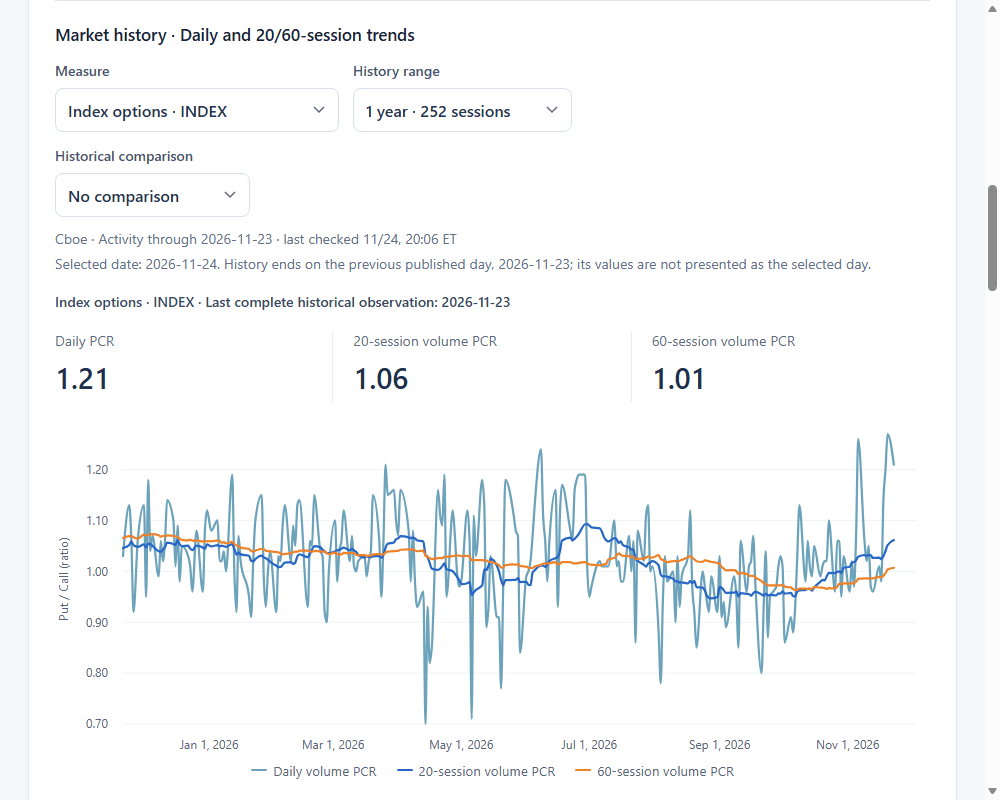
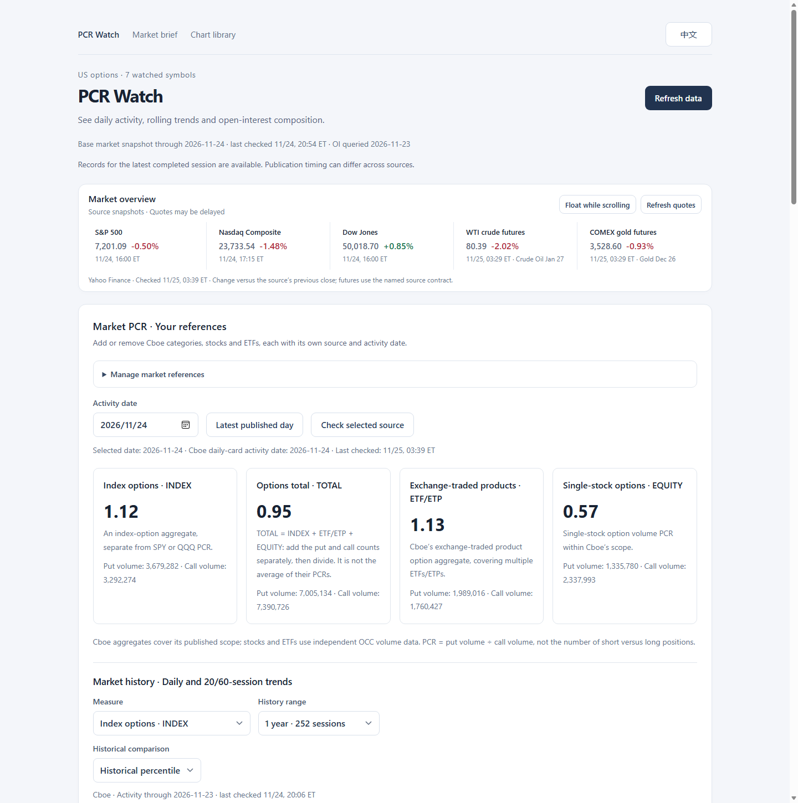
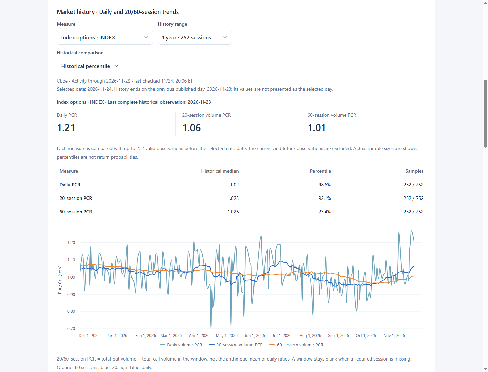

# PCR Market Watch

**English** | [简体中文](README.zh-CN.md)

Explore U.S. options activity through daily Put/Call Ratios, 20- and 60-session trends, historical percentiles, and prior-year comparisons.

[Project homepage](https://rexmiao.github.io/pcr-market-watch/) · [Download](https://github.com/Rexmiao/pcr-market-watch/releases/latest) · [Full product specification](docs/PRODUCT_SPEC.en.md)





## Features

- **Market references:** Cboe INDEX, TOTAL, ETF/ETP, and EQUITY categories, plus stocks or ETFs you add. Every initial recommendation can be removed.
- **Personal watchlist:** Search tickers, press Enter to add, organize groups, and remove symbols. The list is stored in local SQLite, independently of market references.
- **Historical trends:** Daily, 20-session, and 60-session volume PCR, with a date selector and adjustable display range.
- **Historical context:** Percentiles, medians, and sample counts for each PCR measure. Prior-year comparison shows one selected measure at a time.
- **Supporting quotes:** Three major U.S. stock indices, crude oil, and gold, with source timestamps. The floating quote strip can be unpinned.
- **Optional moomoo integration:** A local, read-only market-data adapter. No trading or account operations are exposed.
- **Options activity monitor (since v0.2.0):** Select a symbol and auto/desktop/webapi. Desktop scans at most 20 nearby strikes/40 contracts. Optional WebAPI works without the desktop client and provides provider summaries/unusual events with separate credentials and permissions.



## Windows quick start

1. Install [Node.js 22 or newer](https://nodejs.org/en/download) and [Python 3](https://www.python.org/downloads/). You can select the option to add Python to PATH during installation.
2. Download the Windows ZIP from [Releases](https://github.com/Rexmiao/pcr-market-watch/releases/latest) and **extract it completely**.
3. Double-click `start.cmd`. Keep the CMD window open while using the application; minimizing it is fine.
4. Open the actual address printed by CMD: **http://127.0.0.1:8765/** by default, or an available port such as **http://127.0.0.1:8766/** if another program occupies it.

The Windows ZIP includes the built application. The first run creates the database and initial lists. It does not contain the author's personal database, credentials, or browser profile.

Closing the browser does not stop the backend. Closing the CMD window that owns the server stops that local server. Double-click `start.cmd` to start it again.

If Python is not on PATH, set `PCR_PYTHON` to its executable path. Set `PCR_DB_PATH` to choose a database location; the default is `local-data/pcr.sqlite3`, one directory above the project.

## Run from source

```sh
git clone https://github.com/Rexmiao/pcr-market-watch.git
cd pcr-market-watch
npm ci
npm run build
npm start
```

Open http://127.0.0.1:8765/. Node.js and Python 3 are required. The development dependencies installed by `npm ci` support source builds and database migration development.

```sh
npm test
node scripts/validate-artifact.mjs
```

## Use the options activity monitor

v0.2.1 fixes Auto source selection to prefer a configured WebAPI connection. Explicit desktop/webapi choices remain available; collection errors never silently switch source.

In v0.2.2, open **Options activity** in the top navigation between PCR and Market brief. Its dedicated `/options-monitor.html` page starts expanded; select a current-list stock/ETF and auto, desktop, or webapi. The PCR homepage does not poll options activity; its separate OI summary refresh is manual. Use the actual address printed by the launcher followed by `/options-monitor.html`; [page source](web/options-monitor.html). Desktop mode selects an expiration for bounded contract-quote observations/actual prints. WebAPI supplies provider underlying summaries and unusual events; an expiration filter affects events only, not summary PCR.

WebAPI can operate without moomoo Desktop. Run `node scripts/connect-moomoo-webapi.mjs` and approve the quote:read market-data capability through moomoo's official OAuth PKCE page. Valid provider account-context selectors do not grant account/position access; write, trade, and unknown capabilities remain rejected. A local callback receives authorization; the bundle is stored with Windows DPAPI outside the project, and the backend refreshes using actual expiry information. Grants can expire or be revoked and may need reconnection; access is not permanent. Do not paste tokens into chat or reuse desktop AppKey as Bearer. `scripts/configure-moomoo-webapi.mjs` runs the same OAuth flow. There is no manual-token mode; browsers never hold secrets, and tokens are never written to .env.

Desktop requires signed-in moomoo, external access, and options permissions, scanning at most 20 strikes/40 contracts. It obtains selected-contract fields from basic quotes in batches of at most 20; it does not require the separate full-snapshot endpoint to succeed. WebAPI unusual events are capped at 300 rows per batch with pagination/truncation notices, not a complete tape. Undisclosed exchange/expiration coverage, source times, and exact OI settlement dates stay unknown. Ratios identify their source and do not replace Cboe/OCC historical series.

Initial 500-contract and Volume/OI-of-2 thresholds are editable screening rules. Optional 30/60/120-second refresh runs only while expanded and visible, pausing when hidden/closed without closed-page notifications. Provider BUY/SELL is not an opening/closing flag. Cumulative-volume increments are not one large trade; OI-observation changes do not confirm new shorts or closing trades. Failures remain explicit, retain original data times, never fabricate trades, and do not automatically switch source.

v0.2.3 cards show provider BUY/SELL/NEUTRAL classification and record date/time to the second in New York ET; open/close remains **undisclosed**. Activity cards match their original event; snapshot and interval cards label observation/check times instead. Missing times stay unknown. Put type, side, and OI do not establish net long/short positioning or opening/closing.

Orange highlights mean a screening threshold was met, not bullish/bearish. Read the displayed expiration, strike, and Call/Put. A contract can repeat or meet multiple rules; alert counts are not unique openings or trader counts.

The local Node backend and computer must remain running. Always-on cloud collection needs a separately deployed backend and server secret. GitHub Pages only introduces the project/download and cannot run collection or hold private tokens. This version's hosted Worker has no WebAPI collection path. Existing Sites cloud versions are not automatically updated by local packages.

## Data and interpretation

**PCR = put quantity ÷ call quantity. It is not the proportion of investors who are short, a capital allocation ratio, or a probability of a price move.**

- The 20- and 60-session volume PCRs divide total put volume by total call volume over each window. They are not arithmetic averages of daily PCRs.
- Cboe and OCC have different coverage, publication schedules, and available history. Cboe TOTAL covers the products in its report; it is not an all-U.S.-exchange total.
- Older EQUITY observations are derived by subtracting INDEX and ETP put and call volumes separately from TOTAL, then calculating the ratio. The interface identifies these derived observations.
- In v0.2.2, homepage OI defaults to Latest Moomoo, with Saved Cboe available. Update data checks OCC volume and OI summaries independently, without event polling. Preserve source/check times and unknown T−1 settlement dates. Gray bars appear only in the latest view; historical dates remain blank. Original seeds and monitor contract observations stay separate; missing OI is not zero. The cache is not an OI time series.
- Historical percentiles use up to 252 valid observations before the selected data date, excluding the current and future observations. Actual sample counts are displayed when history is shorter.
- Prior-year curves match the same calendar month and day; missing observations remain blank. For the summary only, a closed-market date can use the latest record within the preceding seven calendar days. Both the target date and actual comparison date are shown.
- When a source has not published a new record, the application retains its last available observation and does not label it as today's data.

Public historical snapshots support display and calculation; their own data dates apply. Publishing the code does not change third-party data rights or terms. See [CBOE_SOURCE_SCOPE.en.md](docs/CBOE_SOURCE_SCOPE.en.md) and [PRODUCT_SPEC.en.md](docs/PRODUCT_SPEC.en.md) for source coverage and methodology.

## Project structure and specifications

| Path | Purpose |
| --- | --- |
| `web/` | Pages, charts, calendar, language switching, historical comparisons, and watchlist interactions |
| `worker/` | Web APIs and data-source adapters |
| `db/`, `drizzle/` | Configuration schemas and versioned migrations |
| `scripts/` | Build tools, local SQLite service, moomoo adapter, and checks |
| `data/` | Dated public-market snapshots |
| `docs/PRODUCT_SPEC.en.md` | User stories, requirements, APIs, algorithms, database constraints, and acceptance criteria |
| `docs/RELEASE_SPEC.en.md` | Release contents, installation behavior, and release verification |
| `site/` | GitHub Pages project showcase; it does not run the full backend |

The current release runs locally. Cloud D1 storage and identity configuration require a separate deployment. GitHub Pages cannot run the SQLite or desktop moomoo backend.

See [MOOMOO_BACKEND.en.md](docs/MOOMOO_BACKEND.en.md) for desktop setup, permissions, and read-only endpoints. Configure the AppKey locally; no key is distributed with the release. There is currently no persistent cloud-to-desktop bridge, AI chat, dealer GEX calculation, or order-entry feature.
