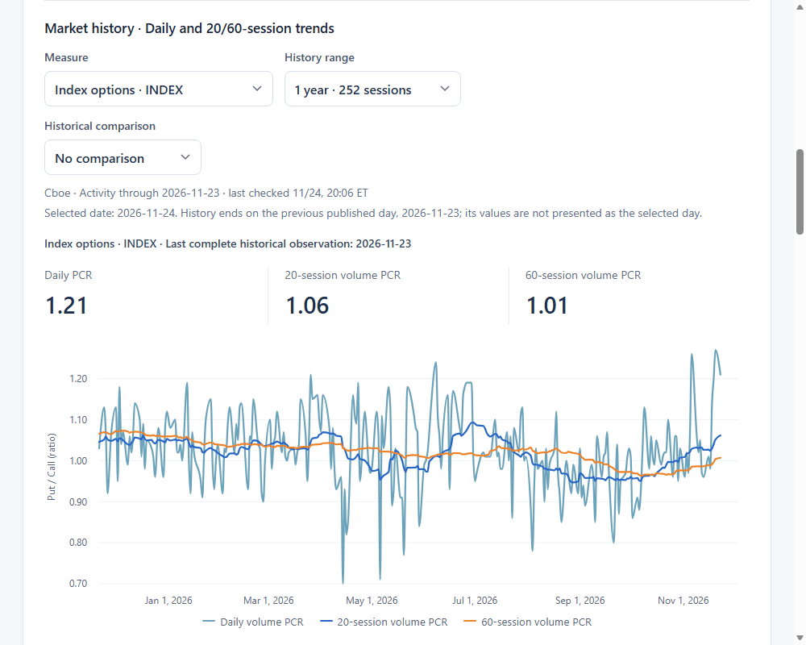
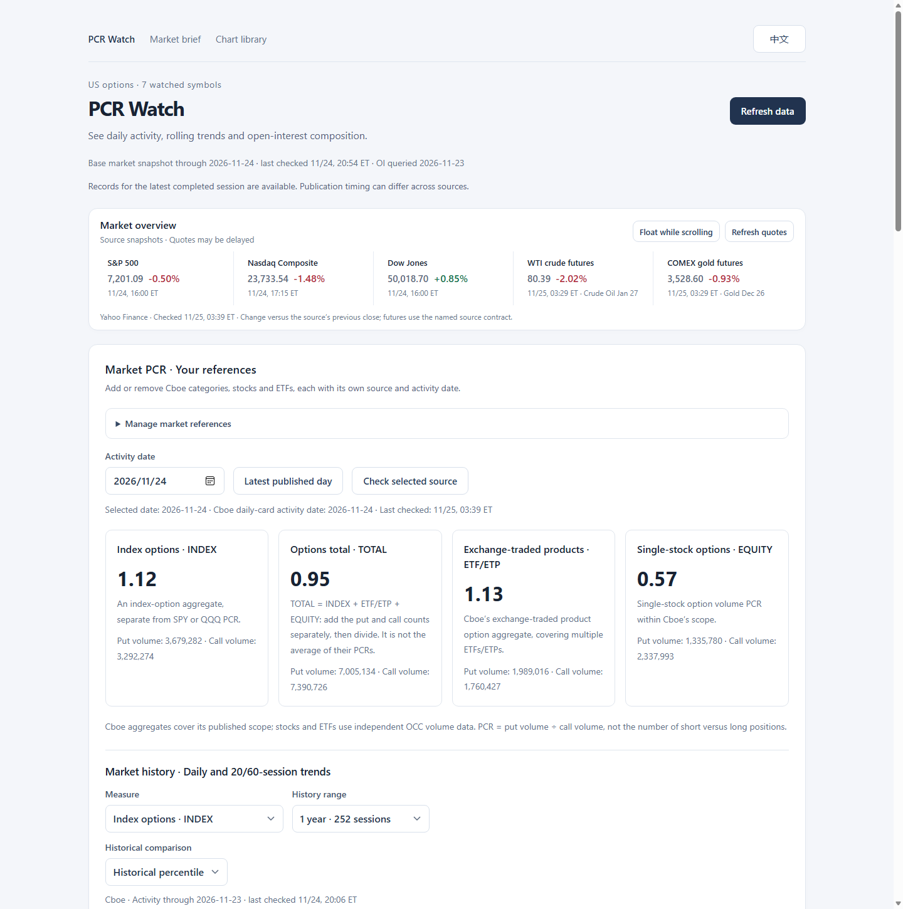
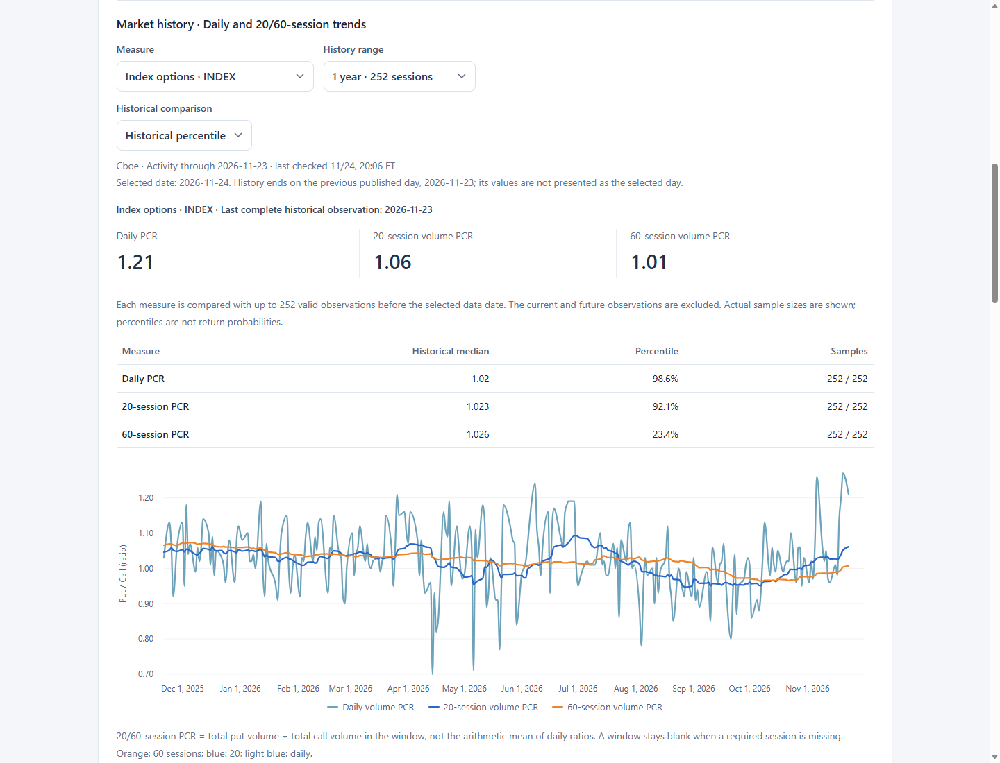

# PCR 观察台 · PCR Market Watch

**简体中文** | [English](README.md)

观察美股期权的每日成交、20／60 日趋势、历史分位和往年同期水平。

[项目主页](https://rexmiao.github.io/pcr-market-watch/) · [下载安装包](https://github.com/Rexmiao/pcr-market-watch/releases/latest) · [完整产品 Spec](docs/PRODUCT_SPEC.md)





## 看什么

- **市场参考**：Cboe INDEX、TOTAL、ETF/ETP、EQUITY，以及自行添加的股票或 ETF。初始推荐项可全部删除。
- **个人自选**：搜索代码、Enter 添加、分类、移除，保存在本地 SQLite；与市场参考名单独立。
- **历史趋势**：单日、20 日、60 日成交量 PCR；选择具体日期和显示区间。
- **历史比较**：分别比较三种 PCR 的历史分位、中位数和样本数；往年同期每次对照一个指标。
- **辅助行情**：三大指数、原油、黄金的报价与源时间；可取消悬浮。
- **可选 moomoo**：本机只读行情适配器；不接交易或账户操作。
- **期权异动监测（v0.2.0 新增）**：选择标的及 auto／desktop／webapi 来源。桌面模式扫描最多 20 个邻近行权价／40 份合约；可选 WebAPI 不依赖桌面客户端，提供供应商标的汇总与异动事件，需独立凭证／权限。



## Windows 快速开始

1. 安装 [Node.js 22 或更新版本](https://nodejs.org/en/download) 和 [Python 3](https://www.python.org/downloads/)。Python 安装时可选择加入 PATH。
2. 从 [Releases](https://github.com/Rexmiao/pcr-market-watch/releases/latest) 下载 Windows ZIP，并**完整解压**。
3. 双击 `start.cmd`。使用期间保留 CMD 窗口，可最小化。
4. 打开 CMD 显示的实际地址，默认 **http://127.0.0.1:8765/**；若其他程序占用，启动器选择例如 **http://127.0.0.1:8766/** 的可用端口。

Windows ZIP 包含已构建的程序。首次运行会创建数据库及默认名单，不附带作者的个人数据库、密钥或浏览器配置。

关闭浏览器不会结束后台；关闭运行后台的 CMD 窗口会结束该次本地服务。再次双击 `start.cmd` 可重新启动。

如 Python 不在 PATH，先设置 `PCR_PYTHON` 为本机 Python 可执行文件路径。`PCR_DB_PATH` 可指定数据库位置；默认在项目目录外一层的 `local-data/pcr.sqlite3`。

## 从源码运行

```sh
git clone https://github.com/Rexmiao/pcr-market-watch.git
cd pcr-market-watch
npm ci
npm run build
npm start
```

打开 http://127.0.0.1:8765/。Node.js 及 Python 3 是必需运行环境；`npm ci` 安装的开发依赖用于源码构建与数据库迁移开发。

```sh
npm test
node scripts/validate-artifact.mjs
```

## 使用期权异动监测

v0.2.1 修复 Auto 选源，优先使用已配置的 WebAPI。仍可指定 desktop／webapi；采集错误不会静默换源。

v0.2.2 从顶部 PCR 与市场解读之间的 **期权异动** 进入独立 `/options-monitor.html` 页，进入默认展开；选择当前名单中的股票／ETF 和 auto、desktop 或 webapi。PCR 首页不轮询期权活动；独立 OI 汇总仅手动刷新。可用启动器打印的实际地址加 `/options-monitor.html` 打开；[页面源码](web/options-monitor.html)。桌面模式选择到期日，查看有限范围合约报价观察／真实逐笔；WebAPI 模式查看供应商标的汇总与异动事件，到期筛选只过滤事件，不能改变汇总 PCR。

WebAPI 模式可不打开 moomoo 桌面客户端：运行 `node scripts/connect-moomoo-webapi.mjs`，在 moomoo 官方页面完成 quote:read 行情读取能力的 OAuth PKCE 授权。合法账户上下文选择器不增加账户／持仓访问权限；写入、trade 及未知能力仍拒绝。本机回调接收结果，授权包存入项目外的 Windows DPAPI 安全存储；后端按实际有效期刷新。授权可过期或撤销，不能保证永久有效；届时需重新授权。无需在聊天中粘贴 token，也不能把桌面 AppKey 当作 Bearer。`scripts/configure-moomoo-webapi.mjs` 运行同一 OAuth 流程，不提供手动 token 模式，不写入 .env；浏览器不保存密钥。

desktop 依赖已登录的 moomoo、外部接口与相应期权权限，最多扫描 20 个行权价／40 份合约。所选合约字段通过基础报价分批读取，每批最多 20 份，不依赖独立完整快照接口成功；webapi 异动列表单批最多 300 条，并标分页／截断，不是完整逐笔带。未知交易所／到期聚合范围、未知数据时间及实际 OI 结算日保持未知。两种来源的 PCR 分别标示，不替代 Cboe／OCC 历史曲线。

默认张数 500、Volume/OI 2 倍只是可调筛选规则。自动刷新可选 30／60／120 秒，仅面板展开且页面可见时运行；隐藏或关闭就暂停，没有闭页通知。供应商 BUY/SELL 不等于开平仓，累计成交量增量不是单笔大单；跨日 OI 观察变化也不确定证明新增空头或平仓。无源或权限失败明确显示，保留旧数据时间，不填假成交；错误后不自动换源。

橘色只表示筛选门槛命中，不代表看多／看空；结合到期日、行权价和 Call/Put 阅读合约。同一合约可重复出现或命中多规则，提示数不等于独立开仓或交易员人数。

本机 Node 和电脑需要运行。持续云端采集需另行部署后端与服务端 secret；GitHub Pages 只展示介绍和下载，不能运行采集或保存私人 token。本版托管 Worker 仍未接入 WebAPI 采集路径；现有 Sites 云端版本不会被本机包自动更新。

## 数据和解释

**PCR = Put 数量 ÷ Call 数量。它不是市场空头人数比例，也不是涨跌概率。**

- 20／60 日成交量 PCR 用窗口内 Put 成交量合计除以 Call 成交量合计，不是每日 PCR 的算术平均。
- Cboe 和 OCC 的来源范围、发布日期和覆盖区间不同。Cboe TOTAL 指其报告覆盖的产品合计，不代表全部美国交易所。
- 较早 EQUITY 历史由 TOTAL 减 INDEX、ETP 的成交量分别推导，界面单独标注。
- v0.2.2 首页 OI 默认“最新 Moomoo”，可选“已保存 Cboe”；“更新数据”独立检查 OCC 成交量与 OI 汇总，不轮询事件。来源／检查时间与未知的 T−1 结算日分开标示。灰柱只在最新视图显示，历史日期空；原种子与异动合约观察保留独立，缺 OI 不是零，缓存也不是 OI 历史序列。
- 历史分位使用所选统计日之前最多 252 个有效历史值，排除当前日和未来数据；样本不足明确显示数量。
- 往年同期曲线按同月同日对齐，缺失不补零；摘要遇休市日最多向前找 7 天，并显示实际日期。
- 源数据未更新时保留最后一次记录，不把旧数据标成今天。

公共历史快照用于展示与计算，日期以数据本身为准；代码发布不改变第三方数据的权利与使用条件。来源及口径见 [CBOE_SOURCE_SCOPE.md](docs/CBOE_SOURCE_SCOPE.md) 和 [PRODUCT_SPEC.md](docs/PRODUCT_SPEC.md)。

## 项目结构与具体 Spec

| 路径 | 内容 |
| --- | --- |
| `web/` | 页面、图表、日历、双语、历史比较和自选交互 |
| `worker/` | Web API 与数据源适配 |
| `db/`、`drizzle/` | 配置表定义及版本化迁移 |
| `scripts/` | 构建、SQLite 本机服务、moomoo 适配和检查 |
| `data/` | 带日期的公共市场快照 |
| `docs/PRODUCT_SPEC.md` | 用户故事、需求、API、算法、数据库约束及验收规则 |
| `site/` | GitHub Pages 项目介绍页，不运行完整后端 |

当前发行包以本地运行方式交付。云端 D1 与身份配置需要单独部署，GitHub Pages 本身不能运行 SQLite / moomoo 后端。

moomoo 的安装、权限与只读接口见 [MOOMOO_BACKEND.md](docs/MOOMOO_BACKEND.md)。AppKey 在本机单独配置，不随发布包分发。当前没有云端访问桌面 moomoo 的常驻桥，也没有 AI chat、dealer GEX 或下单功能。
